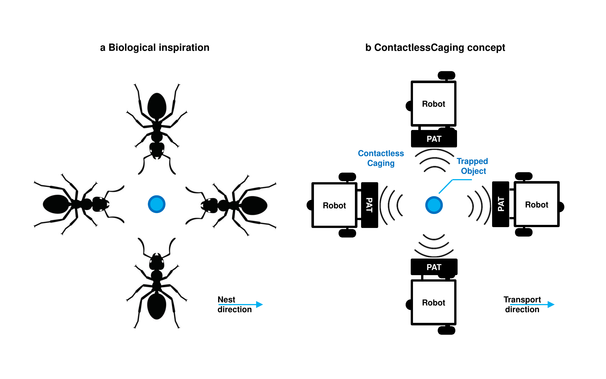

# ContactlessCaging: Collective Contactless Transport via Distributed Acoustic Caging in a Physical Robot Swarm



**Research code, documentation, and integration tools for ContactlessCaging, a four-robot acoustic transport project.** ContactlessCaging uses four mobile ultrasonic phased-array robots to generate and transport a shared acoustic trapping region without contact with the payload. The present study extends the AcoustoBots platform [2] and the two-robot IROS 2025 transport study [3].

## 1. Overview

In ant colonies, groups can surround, stabilise, and transport objects through distributed local interactions, achieving collective performance that exceeds the capability of a single individual. These behaviours have long inspired swarm robotics, particularly in the design of decentralized coordination strategies for transport, assembly, and manipulation.

Ultrasonic phased arrays can generate spatially structured pressure fields that trap and move particles in air without mechanical grasping [1]. Prior work has demonstrated acoustic levitation, dynamic focal control, and contactless transport using static [2] or centrally controlled phased-array systems [3]. However, these systems are typically fixed in space and do not exploit the mobility, reconfigurability, or distributed decision-making that characterize robot swarms [4].

We introduce _ContactlessCaging_ [5], a bio-inspired approach to cooperative contactless transport in which four mobile robots, each equipped with an 8 × 8 ultrasonic phased array, surround a lightweight object and jointly generate a shared acoustic trapping region. Inspired by cooperative caging behaviour in ant colonies, each robot contributes to the acoustic field without physically contacting the object. The above Figure illustrates this biological analogy and the proposed four-robot acoustic caging configuration.

The ContactlessCaging platform consists of four TurtleBot3 Burger robots. Each robot carries an 8 × 8 ultrasonic phased array (PAT) with 64 transducers operating at 40 kHz. The boards face a common trapping region, giving 256 elements in the four-array configuration. The architecture combines:

- **Acoustic actuation:** element-wise joint GS-PAT phase control with calibrated board geometry.
- **Robot coordination:** ROS 2 Humble, independent local PID controllers, a designated leader and three followers.
- **Pose sensing:** external PhaseSpace tracking of PAT-board positions.
- **Timing:** a 40 kHz reference distributed from leader to followers via FPGA–IR electronics.
- **Evaluation:** microphone measurements, PhaseSpace-based trajectories, full-path transport trials and synchronisation measurements.

## 2. Repository contents

```text
ContactlessCaging/
├── ContactlessCaging_Code/
│   └── WirelessBoard/
│       ├── WirelessBoard.sln                          # Visual Studio solution
│       ├── WirelessBoard/
│       │   ├── AcoustoBots_GSPAT_FocalPoint_Hinge_Bead_Cooperative_Four.cpp
│       │   ├── WirelessBoard.vcxproj
│       │   ├── board_mini.pat
│       │   └── ip_addresses.pat
│       ├── AsierInhoUDP/                             # PAT UDP driver
│       └── GSPAT_SolverV2/                           # C++/OpenCL GS-PAT solver
├── ContactlessCaging_Images/
├── ContactlessCaging_Videos/
├── ros2_ws/
│   └── src/contactlesscaging_control/                # ROS 2 support package
│       ├── contactlesscaging_control/
│       │   ├── control_math.py
│       │   ├── formation_controller.py
│       │   ├── phasespace_udp_bridge.py
│       │   └── transport_reference.py
│       ├── launch/
│       └── config/formation.yaml
├── analysis/
│   ├── transport_metrics.py
│   └── pressure_profiles.py
├── docs/
│   ├── ARCHITECTURE.md
│   ├── ACQUISITION_AND_DATA.md
│   ├── DEPLOYMENT_STEPS.md
│   └── SOURCE_PROVENANCE.md
├── tests/
├── .gitignore
└── README.md
```

## 3. Hardware requirements

| Hardware | Role |
| --- | --- |
| 4 × TurtleBot3 Burger, Raspberry Pi 4B | Differential-drive locomotion and ROS 2 coordination |
| 4 × 8 × 8 PAT boards, Murata MA40S4S | 40 kHz acoustic-field emission |
| Adafruit ESP32 Feather V2 | Communication and acoustic driving interface |
| Altera Cyclone IV FPGA and IR TX/RX | Phase-timing reference distribution |
| PhaseSpace tracking system | Global PAT-board pose feedback |
| Laboratory control computer with OpenCL-compatible GPU | Windows C++ GS-PAT acoustic software |
| Brüel & Kjær microphone and XYZ positioning stage | Pressure measurements |
| Oscilloscope | Inter-robot timing measurements |
| 2 mm EPS sphere | Contactless-transport specimen |

**Physical configuration:** The four PAT normals point horizontally inward, towards the common target. The study describes a nominal 5 cm PAT-surface-to-target distance. Check the actual transducer-to-world transforms, mounting geometries, board IDs and local network addresses against the apparatus before energising the PATs.

## 4. Software dependencies

### Acoustic C++/OpenCL project — Windows development computer

- Windows 10/11 x64 and **Visual Studio 2022** with **MSVC v143** and the Windows SDK (from the checked-in `.vcxproj`).
- Compatible **OpenCL** runtime/headers/libraries and **clBLAS** for the GS-PAT solver.
- WinSock2, Visual C++ runtime, `AsierInhoUDP` library and `GSPAT_SolverV2` library.
- `board_mini.pat`, `ip_addresses.pat` and `hologramSolver_V2.cl` in the configured runtime working directory.

Existing Visual Studio project properties refer to laboratory-specific paths. Change these to paths on the target computer. Library versions depend on the selected OpenCL SDK and driver.

### Robot coordination — Ubuntu and ROS 2

- Ubuntu 22.04 LTS and **ROS 2 Humble** on the Raspberry Pi 4B / ROS workstation.
- `rclpy`, `geometry_msgs`, `std_srvs`, `launch_ros`, `ament_index_python`, `python3-yaml` and `colcon`.
- PhaseSpace pose stream: `geometry_msgs/PoseStamped` in metres and a common `world` frame, or the supplied bridge for the historical tracker UDP packet format.
- TurtleBot3 ROS 2 bring-up and accessible `/<robot>/cmd_vel` control topics.

The supplied ROS 2 controller gains and relative positions are starting configuration examples and replace them with laboratory-calibrated values before commanding motion.

## 5. Build the acoustic software (Windows)

1. Clone the repository (or download the assembled repository archive) and open `ContactlessCaging_Code\WirelessBoard\WirelessBoard.sln`.
2. In Visual Studio, select **x64** and the desired configuration (`Debug` or `Release`).
3. Set the OpenCL and clBLAS header/library paths, and build the `GSPAT_SolverV2` and `AsierInhoUDP` library projects.
4. Build the `WirelessBoard` application. The corrected project selects `AcoustoBots_GSPAT_FocalPoint_Hinge_Bead_Cooperative_Four.cpp`, which configures four PAT boards and 256 transducers.
5. Configure the working directory so the `.pat` files and OpenCL kernel are found. Confirm the real IP addresses, IDs, calibration and inward-facing board transforms.
6. Operate the acoustic programme only after checking the four individual phase packets with the FPGA/ESP32 hardware protocol.

The four-array C++ application also contains a keyboard-operated focal-point demonstration (`W/A/S/D` and `Q/E`). Its legacy `F/B/L/R` network commands target an earlier robot interface. The TurtleBot3 motion workflow uses the ROS 2 controllers described below.

## 6. Build the ROS 2 package (Ubuntu 22.04)

```bash
source /opt/ros/humble/setup.bash
sudo apt update
sudo apt install -y python3-colcon-common-extensions python3-yaml \
    ros-humble-rclpy ros-humble-geometry-msgs ros-humble-std-srvs \
    ros-humble-launch-ros
cd ros2_ws
colcon build --symlink-install --packages-select contactlesscaging_control
source install/setup.bash
```

Check the available interfaces:

```bash
ros2 pkg executables contactlesscaging_control
ros2 topic list
```

For one controller on each Raspberry Pi:

```bash
# Robot 1 computer (repeat for robot2, robot3, robot4 on their own computers)
ros2 launch contactlesscaging_control one_robot.launch.py robot_name:=robot1
```

For a single-machine bench session with four controller instances:

```bash
ros2 launch contactlesscaging_control four_robots.launch.py
```

If the tracking host streams the historical PhaseSpace UDP packet used by the older C++ programme, start the UDP bridge:

```bash
ros2 run contactlesscaging_control phasespace_udp_bridge --ros-args \
    -p udp_port:=7777 -p frame_id:=world -p position_scale:=1.0
```

Adjust the position scale, heading units, and tracker-name mapping using `config/formation.yaml`. Consult `docs/DEPLOYMENT_STEPS.md` for the complete execution sequence.

## 7. Contactless transport execution sequence

1. Set the four robot names, PAT-board calibrations, geometry, PhaseSpace trackable names and ROS 2 network configuration.
2. Start the PhaseSpace stream and inspect all four `/phasespace/robotN/pose` topics in the same global frame.
3. Bring up the TurtleBot3 ROS 2 nodes with one robot namespace per robot.
4. Launch one formation-controller process per robot, using the measured global formation offsets. Controllers initialise in the **disabled** state.
5. Inspect a zero-command condition and apply small safe commands to confirm motion direction and `cmd_vel` routing. Enable the individual controllers as appropriate.
6. Start the leader's 100 cm commanded reference at approximately 5 cm/s using the `/formation/start` service.
7. Configure the PAT phase generation, common FPGA–IR 40 kHz timing reference, and acoustic target according to the experimental apparatus, then perform safe acoustic and transport tests.
8. Record robot pose, odometry, acoustic commands, timing traces, and trial outcomes. Stop controllers and disable transducer power at the end of the run.

Example motion enable/start commands:

```bash
ros2 param set /robot1/formation_controller enabled true
ros2 param set /robot2/formation_controller enabled true
ros2 param set /robot3/formation_controller enabled true
ros2 param set /robot4/formation_controller enabled true
ros2 service call /formation/start std_srvs/srv/Trigger '{}'
```

Emergency software stop for each node: `ros2 param set /robotN/formation_controller enabled false`. Use the hardware emergency stop where required.

## References and how to cite

[1] Ceylan Beşevli, Lei Gao, Narsimlu Kemsaram, Giada Brianza, Orestis Georgiou, Sriram Subramanian, Marianna Obrist. SONARIOS: A Design Futuring-Driven Exploration of Acoustophoresis, 2025 ACM Designing Interactive Systems Conference (DIS 2025), Madeira, Portugal, 2025, pp. 740-753 [https://doi.org/10.1145/3715336.3735775] 

[2] Diego Martinez Plasencia, Ryuji Hirayama, Roberto Montano-Murillo, Sriram Subramanian. GS-PAT: High-speed multi-point sound-fields for phased arrays of transducers, ACM Transactions on Graphics, 39(4), Article 138 [https://doi.org/10.1145/3386569.3392492]

[3] Narsimlu Kemsaram, James Hardwick, Jincheng Wang, Bonot Gautam, Ceylan Besevli, Giorgos Christopoulos, Sourabh Dogra, Lei Gao, Akin Delibasi, Diego Martinez Plasencia, Orestis Georgiou, Marianna Obrist, Ryuji Hirayama, Sriram Subramanian. AcoustoBots: A swarm of robots for acoustophoretic multimodal interactions, Frontiers in Robotics and AI, 12, 1537101 [https://doi.org/10.3389/frobt.2025.1537101]

[4] Narsimlu Kemsaram, Akin Delibasi, James Hardwick, Bonot Gautam, Diego Martinez Plasencia, Sriram Subramanian. A Cooperative Contactless Object Transport with Acoustic Robots, 2025 IEEE/RSJ International Conference on Intelligent Robots and Systems (IROS), Hangzhou, China, 2025, pp. 18043-18050 [https://doi.org/10.1109/IROS60139.2025.11245907] 

[5] Narsimlu Kemsaram, Sriram Subramanian. ContactlessCaging: Collective Contactless Transport via Distributed Acoustic Caging in a Physical Robot Swarm, 15 September 2026, PREPRINT (Version 1) available at Research Square [https://doi.org/10.21203/rs.3.rs-10786373/v1]
